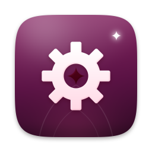

# Vigil Engine

**A product of VigilTech, vigiltech.org.** Founded by **Demetria Althea Cohn**.

**Engine**: Godot 4 with an AI game assembler (editor plugin, game recipe, assembler, templates). Powered by the Godot Engine (MIT); Godot is a trademark of the Godot Foundation; not affiliated or endorsed.

Developed by **VigilTech** for Amerika OS (Ubuntu 26.10 ARM64): describe what you want, and the built-in assistant (Anthropic Claude, through your own API key) builds it. The key is stored in your login keyring by Studio and never reaches the app; see `docs/STUDIO-ARCHITECTURE.md` and `docs/README.md`. Local automation uses the existing Studio bridge; installing OpenClaw is not required.

Source layout: `src/` (installed under `/usr/share`), `tools/builders/engine.py` (Debian package builder used by the Amerika OS build), `tests/`, `docs/engine.md`.
Licence: GPL-3.0-only for VigilTech code (see `LICENSE`); third-party licences are listed in `src/NOTICE`.

## Look

The editor theme follows the VigilTech design system: Night `#120a14` base, one pink accent (`#ff4d86`), Vigil Sans, 8 px corners, and syntax colours that keep at least 6:1 contrast on Night. The theme is seeded on first launch into the Engine's own config directory, so your normal Godot settings are untouched. Design files (tokens, brand guide, Vigil Sans, mark) live in `src/amerika_engine/vigiltech/`; the product icon kit is in `brand/vigiltech/product-icon/`.

Package names, plugin paths, game recipes, project data and Studio APIs remain compatible. VigilTech defaults upgrade only a byte-for-byte original generated theme (v1 or v2); custom editor settings are retained. Godot and all upstream licence notices remain intact.
